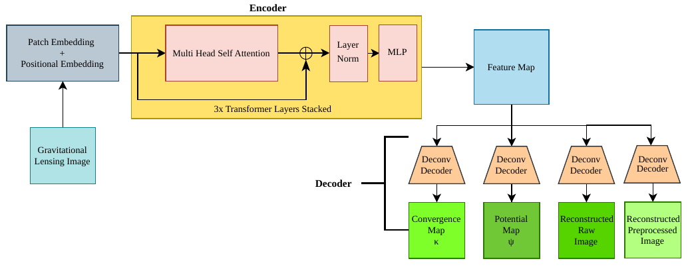

# Architecture and losses

## Model architecture

The shared model is implemented in [`ssl_components/model.py`](../ssl_components/model.py). The encoder converts each image into non-overlapping patches, adds learned positional embeddings, applies Transformer blocks, and projects the resulting token embeddings. Four convolutional decoders produce convergence, potential, preprocessed-image reconstruction, and raw-image reconstruction outputs.



[Open the original architecture PDF](../assets/model_final.pdf).

The pretraining entrypoint constructs `LensModel(64, 16, 1)` with the model's default embedding size (768), depth (3 Transformer blocks), and number of attention heads (12). For a 64×64 input and patch size 16:

- The patch embedding produces 16 tokens on a 4×4 grid.
- Encoder token output has shape `(batch, 16, 768)`.
- The projected latent output is rearranged to `(batch, 768, 16)`.
- The spatial feature map is `(batch, 768, 4, 4)`.
- Each decoder output has one channel and is upsampled to 64×64.

`LensModel.forward` returns `(feature_map, latent_encoding, potential, convergence, image_recon, raw_image_recon)`.

## Pretraining objective

The active objective in `experiments/pretraining/train.py` is:

```text
loss = 1.0 * image_reconstruction_mse
     + 0.1 * raw_image_reconstruction_mse
     + 0.0 * poisson_consistency
     + 0.0 * deflection_curl
     + 0.0 * potential_total_variation
     + 0.0 * kappa_total_variation
     + 0.0 * kappa_nonnegativity
```

The first reconstruction target is a preprocessed image, formed from a clamped, log-contrast image using finite differences and a `tanh` transform. The second target is the per-image log flux, standardized to zero mean and unit scale. The raw-image decoder has no sigmoid activation; the preprocessed-image decoder uses sigmoid.

The physics helper in `ssl_components/utils.py` provides Poisson-style consistency and deflection-curl terms. Their weights are currently zero in the training script, as are the smoothness and nonnegativity terms, so they do not contribute to the default training loss. The training script binds the fourth model output (`convergence`) to a variable named `kappa` and supplies it to the physics terms; since all of those terms have zero weight by default, the convergence decoder receives no gradient from the current objective.

The current `Physics.laplacian_2d` implementation applies a Sobel-like derivative kernel rather than a conventional 2D Laplacian. Treat the Poisson-style term as the implementation currently present in code, and verify the operator before interpreting or enabling it as a physical Laplacian constraint.
